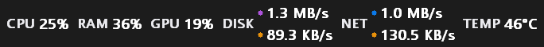
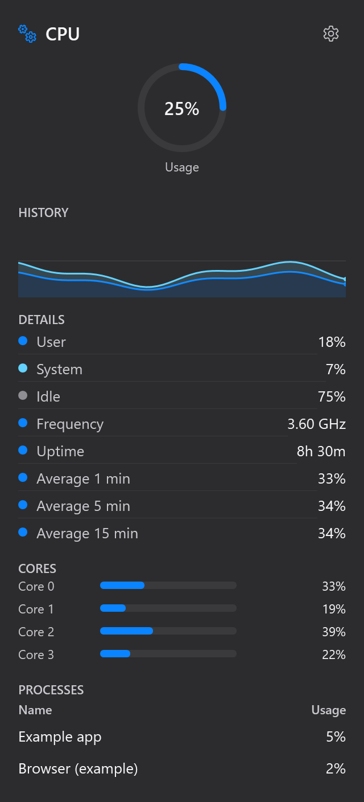
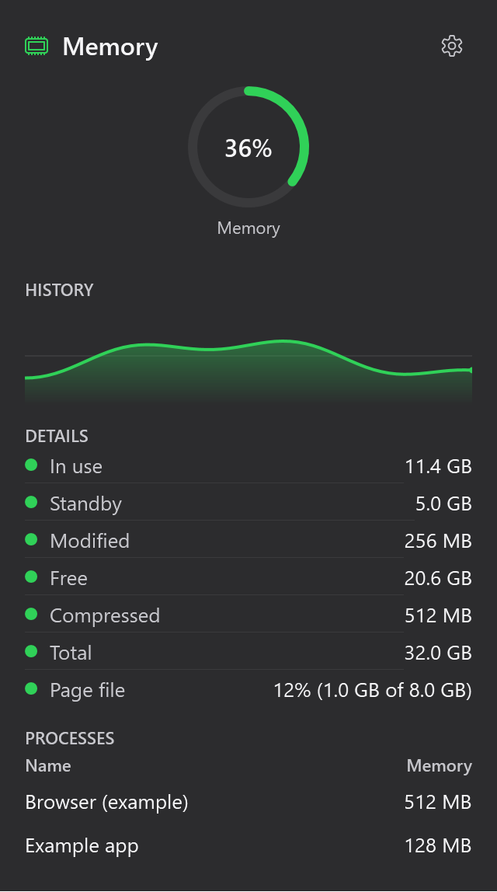
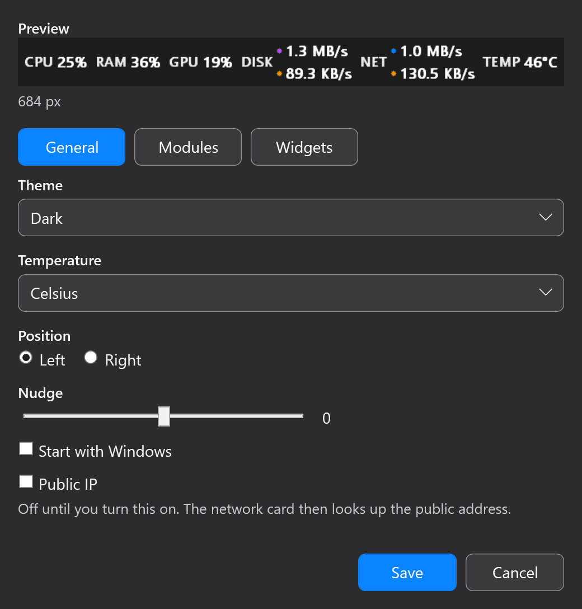

# Win Stats


**System stats in the Windows taskbar.** Win Stats shows live CPU, memory, GPU, disk, network, and available sensor readings in a compact strip.

[Website](https://vc067.github.io/win-stats/) · [Repository](https://github.com/VC067/win-stats) · [Releases](https://github.com/VC067/win-stats/releases)

Maintained by [VC067](https://github.com/VC067).

## Product demonstration

Application UI rendered with illustrative sample values:



<p>
  
  
</p>

<details>
<summary>Customization preview</summary>



</details>

## Features

| Area | What it shows |
| --- | --- |
| CPU | Usage, per-core activity, frequency, uptime, averages, top processes, and optional temperature |
| RAM | In-use, free, standby, modified, compressed memory, page file, and top processes |
| GPU | Usage, engines, VRAM, model, and driver when available |
| Disk | Drive activity, read/write rates, and capacity |
| Network | Download and upload rates |
| Sensors | Optional CPU temperature and available GPU temperature, fan, clock, and power readings, plus session-high temperatures with reset |

Choose Mini, Line Chart, Bars, Rings, or Speed styles, and Minimal, Balanced, or Detailed presets. The theme can follow Windows or use Light or Dark. CPU and RAM process lists are collected only while their panels are open. Hardware sensor values depend on the available hardware and driver; readings that are not available are hidden.

## Installation

Download the [x64 installer](https://github.com/VC067/win-stats/releases/download/v0.1.0/WinStats-Setup-x64.exe). It installs for the current user, adds a Start menu entry named **Win Stats**, and launches Win Stats at the end of an interactive installation. It does not require a separate .NET installation. Builds are currently unsigned, so Windows may show a publisher warning.

Download the [portable package](https://github.com/VC067/win-stats/releases/download/v0.1.0/WinStats-portable-x64.zip). Fully extract the ZIP, then launch `WinStats.exe` from its extracted folder. Portable use does not create a Start menu shortcut.

Win Stats runs on the taskbar and in the notification area. Left-click the Pulse tray icon to open Settings. To start Win Stats when you sign in, enable **Start with Windows** in Settings and select **Save**; this is opt-in.

### CPU temperature

CPU temperature is optional. In Settings, choose **CPU** under **Taskbar temperature** and select **Save**. Windows asks for administrator permission once; Win Stats then installs its small background sensor service and the official signed PawnIO sensor driver automatically. Win Stats itself stays unelevated. The service samples only while a client is active and stops after 10 seconds without one. Make Sensors visible through **Modules** to show temperature in the taskbar.

The Sensors card keeps the highest CPU and GPU temperature for the current session and shows when it occurred. Select **Reset** beside **Session max** to start again. Peaks reset when Win Stats restarts, and turning CPU temperature off clears the CPU peak.

The sensor driver is required because Windows does not expose CPU package temperature to normal applications. Win Stats downloads the pinned official PawnIO 2.2.0 installer from its GitHub release, verifies its SHA-256 hash, and installs it with the same permission prompt. If the automatic download is blocked, Settings shows an **Install sensor driver** link to retry, and the driver can also be installed manually from [pawnio.eu](https://pawnio.eu/). If a CPU does not report a temperature sensor, CPU temperature stays hidden rather than showing an empty reading.

To remove the service, turn CPU temperature off and select **Save**, then use **Remove sensor service** in Settings. Files may remain under `Program Files`, and the shared sensor driver is left installed. Before uninstalling Win Stats, remove the service if it is no longer wanted; the per-user uninstaller cannot silently remove an administrator-installed service.

To check for updates, select **Check for updates** in Settings. Win Stats requests the latest public release tag from GitHub and sends no system readings or identifying system details. If a newer version is available, the app offers to open [GitHub Releases](https://github.com/VC067/win-stats/releases). Updates are installed manually. Before rerunning the installer or replacing portable files, quit Win Stats from the tray menu. Settings are retained in `%LocalAppData%\WinStats\settings.json` across updates. The app collects no usage analytics or system telemetry. The optional public-IP setting is off by default; when enabled, it requests the public IP from [api.ipify.org](https://api.ipify.org).

## Resource use

Measured averages on one Windows 11 PC with 12 logical processors, 13 October 2026:

| State | CPU | Private memory | Working set |
| --- | ---: | ---: | ---: |
| Default strip, idle | 0.17% | 35.4 MiB | 48.9 MiB |
| CPU detail panel open | 0.41% | 98.6 MiB | 116.0 MiB |

Each state includes 30 samples. Usage varies by machine and workload; see the [resource-use notes](docs/PERFORMANCE.md) for method and limits.

## Requirements and limitations

- Windows 11 x64. Windows 10 and ARM64 are unverified.
- The taskbar display uses Windows shell internals and may be affected by Windows updates or shell behavior.
- Available sensor readings depend on hardware and drivers; some values can be unavailable.
- CPU and RAM process details are gathered only while the corresponding panel is open.

## Build from source

Install the .NET 10 SDK on Windows, then run:

```powershell
dotnet restore src/StatsBar/StatsBar.csproj
dotnet build src/StatsBar/StatsBar.csproj --configuration Release
dotnet run --project src/StatsBar/StatsBar.csproj
```

The normal build includes the sensor service output in `SensorsService`. To run the dependency-light sensor regression checks, run `dotnet run --project tests/StatsBar.SensorChecks --configuration Release`.

To package a self-contained x64 build, run `scripts/package.ps1 -Version 0.1.0`. Add `-SkipInstaller` to produce only the portable ZIP and checksums; building the installer requires Inno Setup 6 or 7. The optional self-contained sensor service adds package size. Self-contained packaging downloads the Microsoft runtime packs.

## Contributing

Bug reports and feature requests are welcome through the [issue templates](https://github.com/VC067/win-stats/issues/new/choose). See [CONTRIBUTING.md](CONTRIBUTING.md) for build and change guidance, and [SECURITY.md](SECURITY.md) for private vulnerability reporting.

If Win Stats is useful to you, consider [starring the repository](https://github.com/VC067/win-stats). Development is supported through [Ko-fi](https://ko-fi.com/vedantchhajed).

## License

Win Stats’ original code, website and artwork are licensed under the [MIT License](LICENSE). Third-party components retain their own terms; see [THIRD_PARTY_NOTICES.md](THIRD_PARTY_NOTICES.md).
